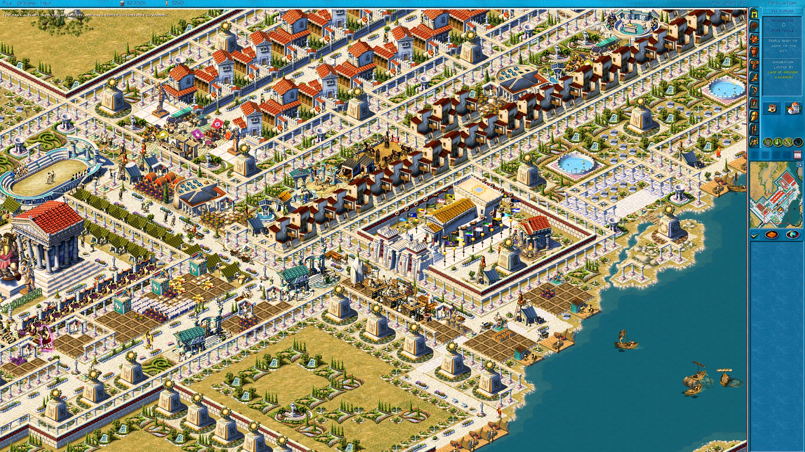
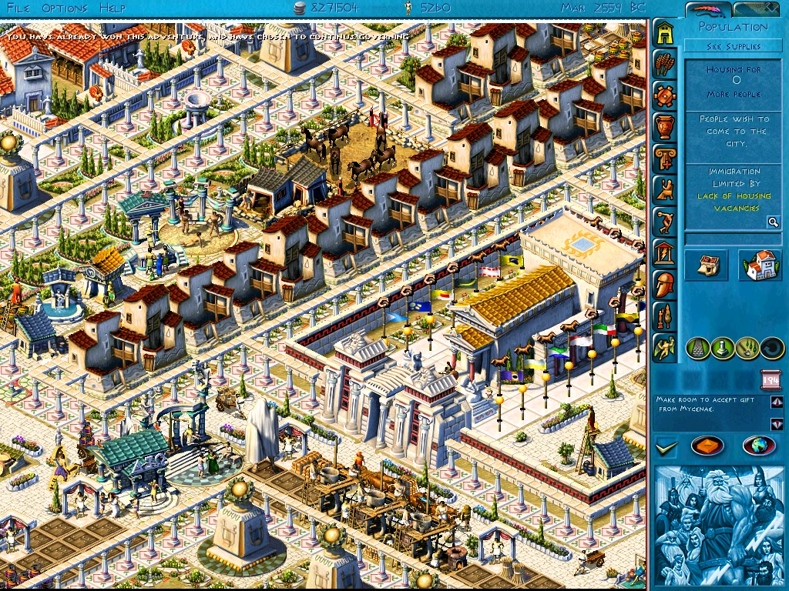

**English** | [繁體中文](readme/README.zh-TW.md) | [简体中文](readme/README.zh-CN.md)

# Pericles

**Modern display and quality-of-life improvements for *Zeus: Master of Olympus* and *Poseidon* (2000–2001).**

| Platform        | Latest release                                                                                                                                             |
| --------------- | ---------------------------------------------------------------------------------------------------------------------------------------------------------- |
| Windows 10 / 11 |  |

On the release page, download **`pericles-<version>.zip`**, not "Source code (zip)": the source code has no `ddraw.dll`. Then see [Installation](#installation).

Pericles keeps the original game and makes it fit today's computers: it runs at your screen's resolution with the interface laid out for it, and adds quality-of-life improvements, set in an Options window in the game's own style. More is on the way, gameplay options included. It is named after Pericles, the Athenian statesman who had the Parthenon built — in the tradition of [Julius](https://github.com/bvschaik/julius), [Augustus](https://github.com/Keriew/augustus) and [Akhenaten](https://github.com/dalerank/Akhenaten) for the other Impressions city builders.

If you also play *Emperor: Rise of the Middle Kingdom*, you may like the sister project, [Yongle](https://github.com/riap0526/yongle): it is built on the same engine and with the same approach as Pericles.

*A city at 2560×1440 with Pericles, display scale 100 %. Click any screenshot for full size.*

For comparison: the original game at 1024×768

## Features and Roadmap

See **[docs/FEATURES.md](docs/FEATURES.md)** for details and screenshots of each feature.

See **[docs/ROADMAP.md](docs/ROADMAP.md)** for what is planned next and what comes later.

See **[CHANGELOG.md](CHANGELOG.md)** for what changed in each release.

- **No display mode changes:** the game runs in a borderless full-screen window at your desktop resolution, scaled up sharply.
- **Smooth frame rate** at your monitor's refresh rate. The game's own timing doesn't change.
- **Any resolution:** the side panel, top bar, city and dialogs fit your screen, and a display scale (100–250 % or *Auto*) makes every screen bigger.
- **A side panel modeled on Emperor's**, with the minimap always shown. If you prefer the game's own side panel, switch back in Options > General > Interface.
- **Animations at their designed speed** for every building and person. On today's computers, the original moves the gods too slowly and some buildings far too fast; Pericles fixes both.
- **Menus, loading screens and the world map** are shown in a frame, over a blurred picture of your city.
- **Windowed mode** (F5 or Alt+Enter). You can resize the window, and its size and position are remembered.
- **Smooth scrolling** of the city, with a steady speed for each scroll speed setting.
- **City zoom** with the mouse wheel (50–150 %, less on small maps), toward the cursor. The middle mouse button goes back to 100 %.
- **Drag scrolling** with the middle mouse button.
- **Options window** (F6) with the game's settings and Pericles's together.
- **Key rebinding** for almost every key, with two keys per action, and **overlay keys**.
- **Esc closes windows** and opens a **Pause menu** in the city.
- **Difficulty and auto defend** in Options, too.
- **Steady game speed:** a big city at a high resolution no longer runs slower than the speed you set, and 100 % is a steady speed, one step above 90 %, instead of as fast as your computer can draw.
- **Sound:** a master volume, music and sounds that pause while you're switched away, ambient sounds at a steady rate, and the game's 3D nature sounds without the stutters they caused.
- **Screenshots** (F11), **full city and minimap screenshots** (F10, Shift+F10) and **problem reports** (F12).
- **The adventure editor's world map** at your resolution too.

## How it works

Pericles is a single `ddraw.dll` in the game folder. It replaces the game's DirectDraw with its own (Direct3D 11 or 9 through SDL3) and changes the original `Zeus.exe` in memory only. The game's files and your saves are never modified. If one of Pericles's features runs into an error, it turns itself off and the game carries on as the original would. Delete `ddraw.dll` and the game is exactly as before. A full reimplementation that no longer needs `Zeus.exe` is a long-term goal.

**The original art stays as it is:** everything on screen is drawn from the game's own images. There are no plans for AI-generated or AI-upscaled backgrounds, artwork or other images.

## Requirements

- The **English** *Zeus + Poseidon* (*Zeus: Master of Olympus* with its expansion *Poseidon*), `Zeus.exe` version 2.1.4.0, as sold by **GOG** and **Steam**: both have the same `Zeus.exe` (SHA256 `382bcd286192a06eb8fdc45f5c37390a19999f5db9c940c3ce2dfcd775e90a57`). They only sell the English edition. Other languages were only sold on the original retail CDs: Pericles may work with them, but it may have problems, or some of its features may not work.
- Use an unmodified `Zeus.exe`: an exe changed by another tool (a widescreen patch, say) may not work or may cause problems. With any `Zeus.exe` other than the one above, Pericles shows "Untested Zeus.exe" at the top of the screen for 20 seconds at the start (see the [FAQ](docs/FAQ.md#which-versions-of-zeus-does-pericles-work-with)).
- Windows 10 or 11 and a graphics card with Direct3D 11.

## Installation

1. Download `pericles-<version>.zip` from the [latest release](https://github.com/riap0526/pericles/releases/latest) (not "Source code (zip)") and unpack it. `ddraw.dll` is not code-signed, so antivirus or SmartScreen may warn about it; you can check the zip against the SHA256 on the release page.
2. Copy `ddraw.dll`, `ddraw.syms` and `zeus_engine.ini` into the game folder (the folder with `Zeus.exe`; on Steam: right-click the game > Manage > Browse local files). If the folder already has a `ddraw.dll` from another tool (cnc-ddraw, dgVoodoo and so on), back it up first: only one can be used.
3. Start the game as usual (from GOG Galaxy and Steam too).

**Upgrade:** replace `ddraw.dll` and `ddraw.syms` and keep your `zeus_engine.ini`; Pericles brings it up to date at the first start.

**Uninstall:** delete `ddraw.dll`. Which other files Pericles creates, where they are (the game folder, or `Documents\My Games\Pericles` when the game is under Program Files), skipping the intro movie and switching the renderer: see the **[FAQ](docs/FAQ.md)**.

## Keys

Pericles's keys (the defaults):

| Key             | Action                                                                                                                      |
| --------------- | --------------------------------------------------------------------------------------------------------------------------- |
| Esc             | Close a window or go back. In the city: drop the building tool, or open the Pause menu. On the main menu: quit (asks first) |
| F6              | Open / close Options                                                                                                        |
| F5 or Alt+Enter | Switch between full screen and a window                                                                                     |
| F10             | Full city screenshot to `shots\`                                                                                            |
| Shift+F10       | Minimap screenshot to `shots\`                                                                                              |
| F11             | Screenshot to `shots\`                                                                                                      |
| F12             | Problem report (when something looks wrong)                                                                                 |
| Insert          | Open / close the debug panel                                                                                                |
| Tab             | With Pericles's side panel: switch its box between the minimap and the messages                                             |
| Mouse wheel     | Over the city: zoom in and out. Over the side panel: the building category, as in the original                              |
| Middle button   | Over the city: hold and move to drag the city; click to zoom back to 100 %                                                  |

The game's own keys work as in the original, and the overlays have keys of their own (see [FEATURES](docs/FEATURES.md#options-and-keys)). Almost all of them, and Pericles's keys above, can be changed in **Options > Hotkeys**, with a second key for each action. Not offered: the developer and cheat keys of the game, keys used for typing text, and Esc, Enter, the mouse wheel and the middle button (F5 and Alt+Enter cannot be changed either).

## Settings

Most settings are in **Options** (on the main menu, in the Options menu of the city and the editor, or F6), together with the game's own options. The **debug panel** (Insert) has the settings for testing and for fixing the display when something goes wrong. All of Pericles's settings are also in `zeus_engine.ini`, which explains each one; a missing file or setting means the default.

## Known issues

Questions about where Pericles's files are, the intro movie or the renderer? See the **[FAQ](docs/FAQ.md)** first.

The full list is in **[docs/KNOWN_ISSUES.md](docs/KNOWN_ISSUES.md)**. The main points:

- On laptops and slower computers, **lowering the resolution** (a higher display scale, or *Auto*) helps performance most.
- Game copied under `C:\Program Files (x86)` by hand: Pericles's files are in **`Documents\My Games\Pericles`**, not in the game folder. GOG Galaxy and Steam installs keep them in the game folder (see the [FAQ](docs/FAQ.md)).
- Tested on AMD graphics and Intel integrated graphics so far; NVIDIA, real 4K monitors and several monitors not yet.

## Reporting problems

Please open an issue with the **Bug report** form. In short: delete `ddraw_proxy.log` in Pericles's folder (the game folder, or `Documents\My Games\Pericles`; see the [FAQ](docs/FAQ.md)), reproduce the problem and press **F12** the moment you see it, then send the new `ddraw_proxy.log`, the `shots\report*` pictures and your `zeus_engine.ini`, with what you did, what you saw, your screen resolution, Windows version and graphics card.

## Building and Contributing

See **[docs/BUILDING.md](docs/BUILDING.md)** for the tools, the build steps, the offline tests and the code layout.

See **[CONTRIBUTING.md](CONTRIBUTING.md)** for how to propose changes and the rules contributions follow.

## Credits

- **[Augustus](https://github.com/Keriew/augustus)** (AGPL-3.0): its speed easing code (`core/speed.c`) is used for smooth scrolling (see `third_party/augustus/`), and its display scale, game speed, configuration, hotkey and pause menu designs were the models for ours.
- **[Julius](https://github.com/bvschaik/julius)**: studied for its rendering and timing.
- **[Akhenaten](https://github.com/dalerank/Akhenaten)**: its description of the `.sg3` image format was the reference for reading the game's own images.
- **[OpenRCT2](https://github.com/OpenRCT2/OpenRCT2)**: the approach of starting inside the original executable.
- **Pecunia's Zeus and Poseidon animation fix patch** (2018): studied to find where the original's people animations go wrong (no code used).
- **[zeus-qol](https://github.com/andrehamon/zeus-qol)**: studied for how its Zeus improvements are structured, its map scaling and its city image export (no code used).
- Libraries: [SDL3](https://github.com/libsdl-org/SDL) (zlib), [Dear ImGui](https://github.com/ocornut/imgui) (MIT), [MinHook](https://github.com/TsudaKageyu/minhook) (BSD-2-Clause), miniz (public domain, the copy in SDL). Their licenses are in [THIRD_PARTY_NOTICES.md](THIRD_PARTY_NOTICES.md).
- *Zeus: Master of Olympus* and *Poseidon* were made by Impressions Games and published by Sierra.

## Disclaimer

Pericles is an unofficial fan project. It is not affiliated with or endorsed by the owners of *Zeus: Master of Olympus* and *Poseidon*. You need your own copy of the game; Pericles contains none of its files.

Developed with AI assistance. Every stage is playtested in the game before release. Use it at your own risk and keep backups of your saves.

## License

Pericles is licensed under the **GNU Affero General Public License v3.0** — see [LICENSE](LICENSE). Third-party components keep their own licenses; see [THIRD_PARTY_NOTICES.md](THIRD_PARTY_NOTICES.md).
