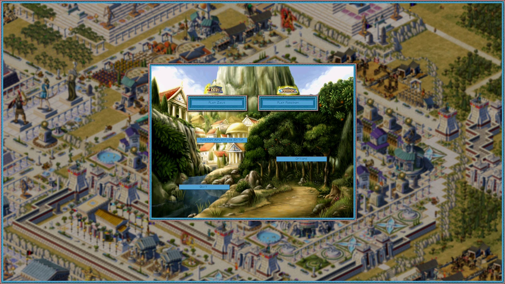
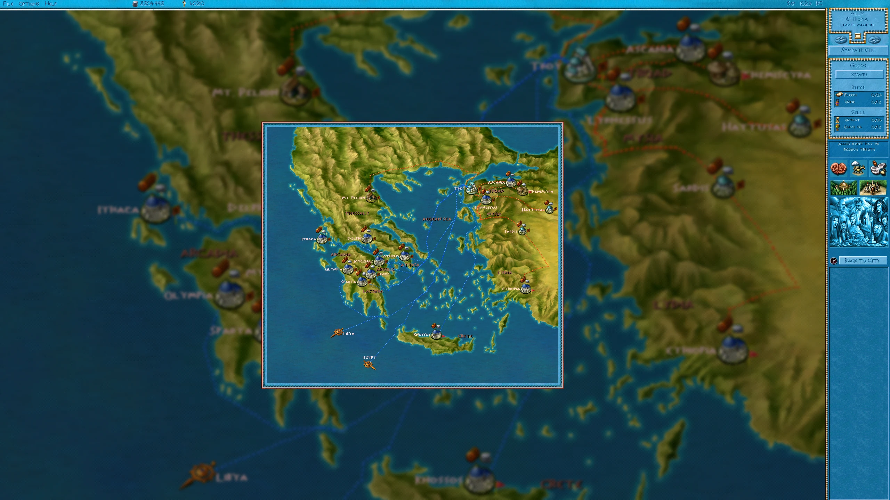
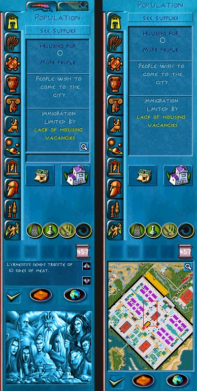
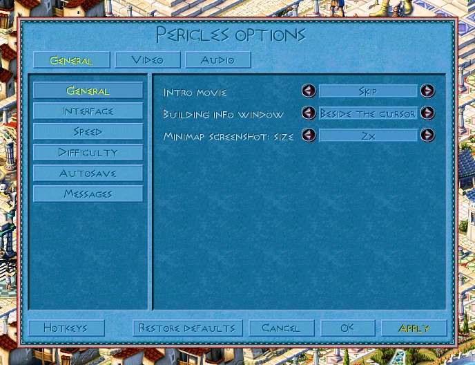
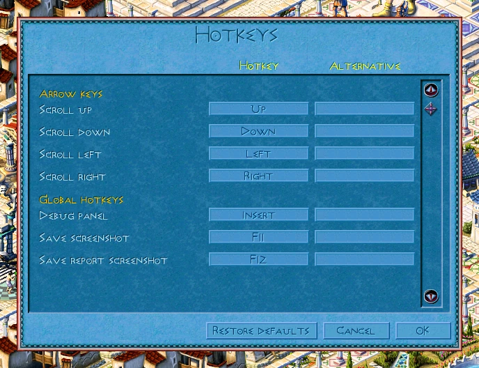
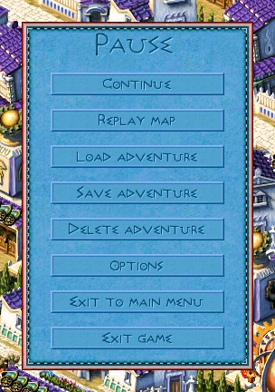
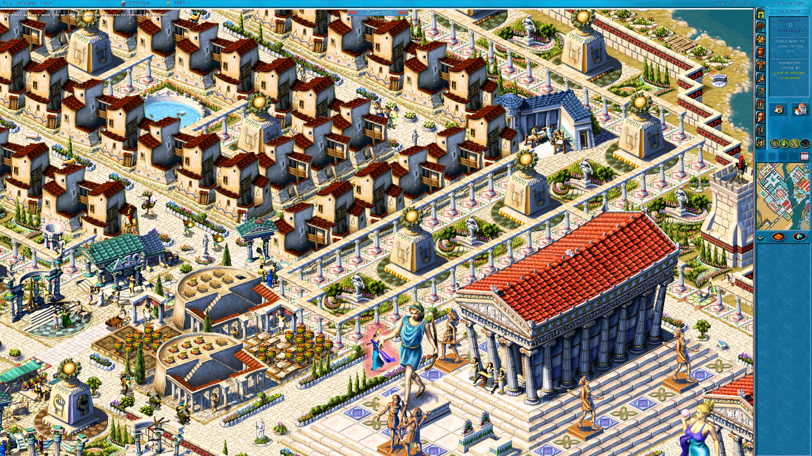
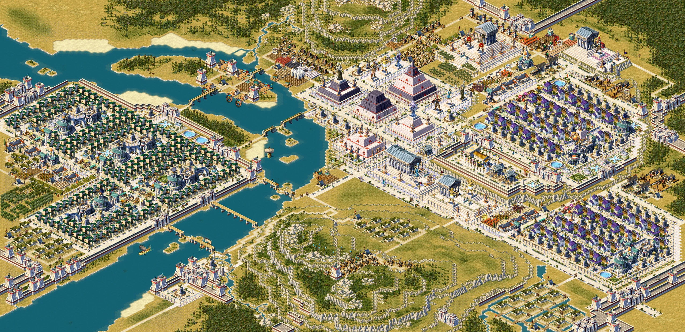
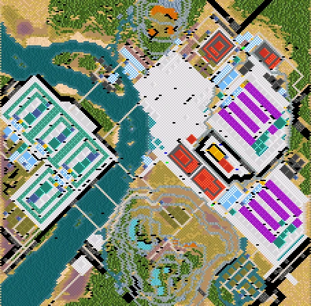

# Features

Back to the [README](../README.md). Most settings are in the Options window (F6, the Options menu in the city and the editor, or the main menu). All of them are also in `zeus_engine.ini`. See [Settings](../README.md#settings).

Everything here works in *Zeus* and in *Poseidon* alike.

## Display

- **No display mode changes.** Your desktop resolution stays as it is. The game runs in a borderless full-screen window and is scaled up sharply (nearest pixels, with a one-pixel blend at the edges). You can also pick plain nearest pixels or smooth scaling (Options > Video > Scaling).

- **Smooth frame rate.** The picture updates at your monitor's refresh rate instead of the original's ~20 frames a second. The game's own timing (simulation, animations) doesn't change.

- **Animations at their designed speed.** On today's fast computers, the original's animations go wrong in two ways, and Pericles fixes both where they start, in the game's own timing:
  - **People** (gods, heroes, urchin collectors and many others) animate slowly or unevenly. Their animations only move on when a simulation step falls on the moment a timer is due, and the timers were made for computers that drew about 20 pictures a second. Pericles gives the simulation its own clock, so every person animates at the speed the game's art was made for.
  - **Some buildings** (hippodrome spectators, trading posts and others) animate far too fast, because they move on every time the city is drawn, hundreds of times a second today. Pericles counts the city's drawing as a computer of the time did, about 20 times a second, while the picture still updates at your refresh rate.

  This covers every building and person, and changes nothing in `Zeus.exe`. An earlier community patch (2018) changed 70 bytes of `Zeus.exe` so that 20 kinds of people move on every simulation step: they no longer stall, but run faster than designed, and the buildings stay too fast.

- **Any resolution.** The game runs at your screen's resolution divided by the display scale (100–250 % in 5 % steps, or *Auto*, which makes it 1080 pixels high on bigger screens, e.g. 1920×1080 on a 2560×1440 monitor). The side panel and top bar reach the edges of the screen, the city fills the rest, and dialogs are centered. Without Pericles, the game starts at its own 1024×768 as before.

- **Every screen uses the display scale.** Menus, briefings and loading screens get bigger along with the city. They are shown in a frame instead of stretched, and only made smaller if they don't fit. Around the menus you can have a blurred, darkened picture of the last city you played (or a picture of your own, see [MENU_BACKGROUND.md](MENU_BACKGROUND.md)), the game's own panel pattern, a fret border with black around, or black like the original (*Menu screens*).

  

- **World map** at its normal size or bigger (to fit the screen, or by a percentage), centered over a blurred copy of itself or over your city. The campaign map and the adventure editor's world map are shown the same way, always over the blurred map.

  

- **Windowed mode**: F5 or Alt+Enter. You can move, resize and maximize the window, and the game adjusts to the new size. The window's size and position are remembered. You can also keep the mouse cursor inside the window.

- **Information window position.** You can choose where a building's information window opens: as in the original, in the center, or next to the cursor (default).

## Side panel

- **A side panel modeled on Emperor's** (default; Options > General > Interface switches back to the game's own):
  - The minimap is always shown, in a larger box at the bottom. The box can show the city's messages instead, several at a time; click one to open it. A button by the box, or **Tab**, switches between the two.
  - The tabs are gone: the title, the overlay buttons and the information area move up, and the information area is taller. Click the title to open or close the report (the title lights up under the mouse).
  - The names of the categories, buttons and buildings appear in the game's own tooltips, following *Balloon help* in the Help menu. The costs under the building buttons stay.
  - The same layout is used for the side panel of your troops and ships, and the world map and campaign map side panels match it. On screens taller than 768 pixels, the space below is filled with the game's own panel.

  
  *Left: the game's own side panel. Right: Pericles's, with the minimap in the box at the bottom.*

## Options and keys

- **Options window.** A settings window that looks like the game's own dialogs, made from the game's panels, buttons and font. It has the game's settings (game speed, scroll speed, autosave, messages, music, speech and sound volumes) and Pericles's settings together, on General, Video and Audio pages. Open it with **F6**, from the Options menu in the city (General Settings, Video, Audio, Hotkeys, Difficulty, Autosave, Auto Defend) or in the editor, or from **Options** on the main menu. Hover over a setting to see what it does. *Restore defaults* resets only the section you are looking at. If you change the resolution or display scale, the game asks "Keep this setting?" and switches back after 15 seconds if you don't answer. The game's own settings are still saved in the game's files, so they are the same without Pericles.

  

- **Key rebinding** (Options > Hotkeys). You can change almost every key in the game (scrolling, rotating the map and buildings, speed, pause, building categories, bookmarks, army groups) and Pericles's own keys, with a main and an alternative key for each action. Click a key, then press the new one (Ctrl, Shift and Alt combinations work). Right-click a key to clear it. The mouse side buttons can be used too. If a key is already used, or the game needs it for itself, the window tells you instead of taking it. The default keys are the same as the original game, and the "Game paused" message shows your pause key.

  

- **Overlay keys.** Each overlay (supplies, water, hygiene, hazards, unrest, taxes, culture, appeal and the others) has a key of its own, which the original does not have, and Space switches the current overlay on and off, as in the original. The overlay keys work like the overlay buttons of the side panel, and can be changed in Options > Hotkeys.

- **Esc closes windows**, like a right click, including confirmation boxes (Esc means No). In the city, Esc cancels the building tool or lets go of the selected troops or ships first; otherwise it opens the **Pause menu** (Continue, Replay map, Load adventure, Save adventure, Delete adventure, Options, Exit to main menu, Exit game). The game is paused while the menu is open. In the editor, the Pause menu has that screen's File menu and Options. On the menu screens, Esc goes back like a right click, and on the main menu it asks before quitting. On the end-of-episode screens it does nothing.

  

- **The File menu** has the same items, plus the two city screenshots: Replay map, Load adventure, Save adventure, Save city screenshot, Save minimap screenshot, Delete adventure, Exit to main menu, Exit game. Replay map and Exit to main menu ask first.

- **Difficulty and auto defend** in the Options window too. While you play a city, they are in Options > General > Difficulty, besides the game's own Difficulty and Auto Defend in the Options menu.
  - *Difficulty* (Beginner to Olympian) changes at once, one level at a time, as the game itself does it. The episode's result counts the lowest difficulty you played it at: once you lower it, raising it again later does not change that.
  - *Auto defend*: when enemies come, your soldiers gather and march out by themselves. It can't be changed while enemies are attacking.

- **New players start at 80 % game speed and 50 % scroll speed** (the original defaults are 90 % and 60 %), which work better with smooth scrolling. If you have played before, your settings stay the same.

- **Intro movie**: play it (default) or skip it (Options > General). The game's own files are not changed.

## Gameplay feel

- **Smooth scrolling.** The city scrolls pixel by pixel and eases in and out. Each scroll speed setting has its own steady speed, the same on every computer, from slow at 10 % to fast at 100 %.
- **Drag scrolling.** Hold the middle mouse button over the city and move the mouse: the city follows it. The cursor is hidden while you drag and comes back where you pressed. A click without moving still goes back to 100 % zoom. It works in the editor too. You can turn it off in Options (*Drag scrolling*).
- **Edge scrolling width.** How close to the edge of the screen the cursor has to be to scroll the city: 1 pixel as in the original, up to 20, or 0 to scroll only with the keys and the mouse (Options, *Edge scrolling: width*).
- **City zoom.** Turn the mouse wheel over the city to zoom out and see more, or zoom in to see it bigger, in steps of 25 % from 50 % to 150 % (less on small maps, so the view stays inside the map). A "Zoom" message at the top shows the current level. The spot under the cursor stays in place, and the zoom is animated when smooth scrolling is on. The middle mouse button goes back to 100 %. Over the side panel, the wheel still changes the building category. Clicking, building, selecting and sounds all work at any zoom, and the side panel and menus keep their size. You can set the zoom the game starts with (*Starting city zoom* in Options > Video); zooming with the wheel is not saved, and saved games are not affected. Zooming out is slower, because the game has more of the city to draw. The editor does not zoom.

  

- **Steady game speed.** In the original, a big city at a high resolution runs slower, because the simulation waits for the drawing. Pericles catches up on the missed simulation steps (like Augustus), so the game runs at the speed you set at any resolution. Time spent in a window or the Pause menu is not caught up, so the city doesn't jump when you close it.
- **Predictable 100 % speed.** In the original, 100 % runs as fast as your computer can draw. By default Pericles limits it to a steady speed, one step above 90 % (you can switch back to the original).
- **The city keeps running while you scroll** (the original pauses it; you can switch this back).

## Sound

- **Master volume and mute** for all music and sounds (Options > Audio). The game's own volume settings are kept.
- **Music and sounds pause when you switch away** (Alt+Tab, clicking another window, minimizing) and continue where they left off when you come back. The original stops them and starts a different song (you can switch back to that).
- **Ambient sounds at a steady rate**, about one every two seconds on any computer and at any resolution. In the original, the rate depends on how fast the game runs (you can switch back to that).
- **Nature sounds without stutters.** The game's 3D sounds (wind, bells and others) made the city stop for about a fifth of a second every ten seconds or so. Pericles turns the game's 3D sound off and plays these sounds itself, the way the game designed them, recreated in stereo: one comes down from above, moves around you for a while and rises away again, about every 30 seconds, at the ambient sounds volume. On by default; you can turn it off in Options > Audio > Nature sounds.

## Editor

- **The adventure editor** works as before. Its world map runs at your resolution, like the game's; a city you edit is at your resolution, with the side panel reaching the bottom of the screen; the editor's main screen is shown at the game's own 1024×768, in a frame.
- In the editor, Esc in a name box cancels it, and the City Properties window opens beside the side panel.

## Screenshots and tools

- **Full city screenshot** (F10, or File > Save city screenshot). Saves the whole city, as far as you can scroll, as one PNG at the game's normal size, without the interface, whatever the zoom. A big city on a big map gives a picture of about 6700×3300 pixels. The game pauses for a moment while the city is drawn, and the file is saved in the background while you keep playing.

  

- **Minimap screenshot** (Shift+F10, or File > Save minimap screenshot), twice the size of the minimap by default.

  

- **F11** saves a screenshot of the game to `shots\`. Messages like "screenshot saved" or the zoom level appear in the game's own message boxes.
- The game's own **Alt+1 and Alt+2** BMP screenshots are not saved, because the game can't make them above 1024×768. With `backend = system`, where the game runs at its own sizes, they are saved as before.

- **F12** writes a problem report (a mark in the log, screenshots, statistics, recent display changes) to attach to bug reports.

- **Debug panel** (Insert): settings for testing and for fixing the display if something goes wrong, plus the folder where Pericles keeps its files. "Show all settings" lists everything else.

- **Error details in the log.** If something goes wrong, the log (`ddraw_proxy.log`) shows where, with function names and source lines (from `ddraw.syms`).
